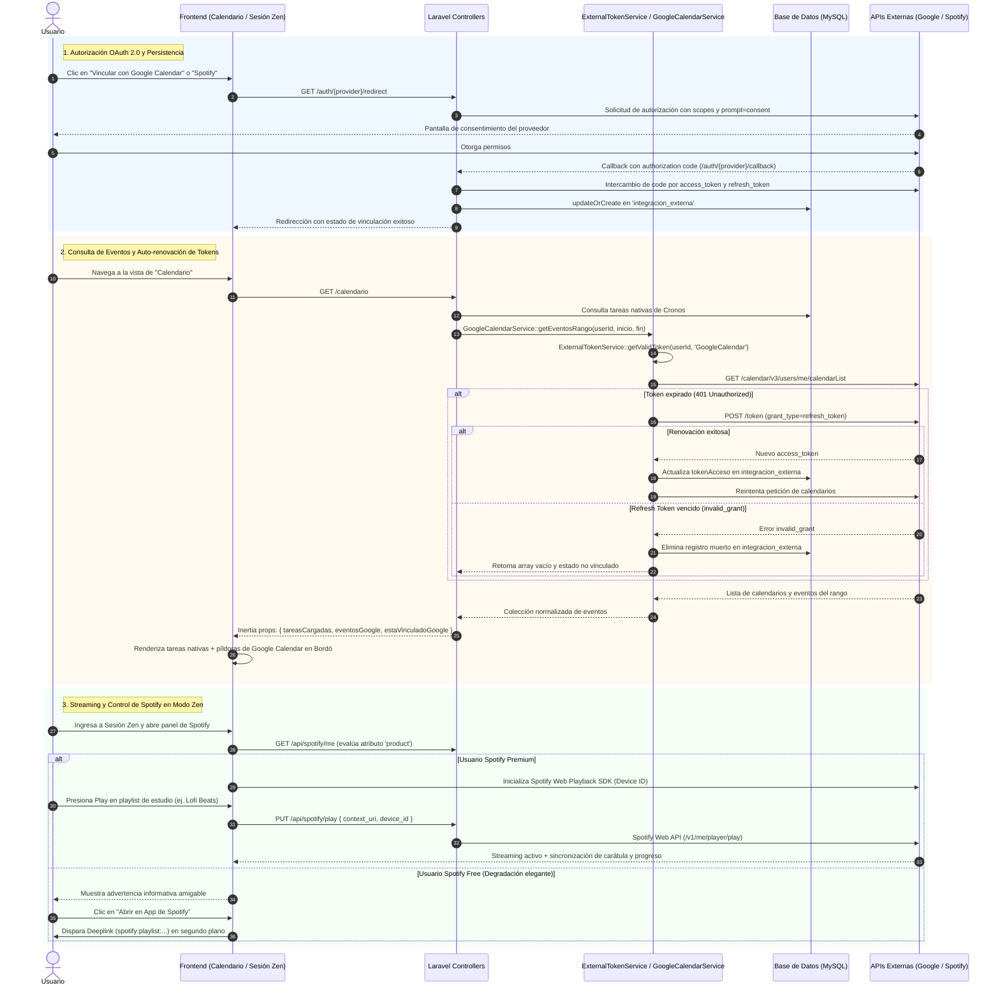

# [RF-M15] Sincronización Completa con Google Calendar y Spotify

## 1. Descripción y Objetivo

Este requerimiento consolida la interoperabilidad del ecosistema Cronos Notes con plataformas líderes de productividad y multimedia (Google Calendar y Spotify), eliminando la fricción y el constante cambio de contexto (*context switching*) que experimentan los estudiantes entre su temporizador Pomodoro, su agenda personal y la reproducción de música ambiental.

El requerimiento comprende dos ejes principales de integración:

### 1.1. Sincronización con Google Calendar
- **Exportación de Compromisos (Cronos ➔ Google Calendar):** Permite exportar automáticamente aquellas tareas que dispongan de fecha y hora límite (`fechaLimite`), así como bloques de sesiones de estudio Pomodoro programadas, insertándolas como eventos en el calendario principal de Google del usuario bajo el tag identificatorio `[Cronos]`.
- **Proyección de Disponibilidad y Recordatorios (Google Calendar ➔ Cronos):** Recupera los eventos programados en Google Calendar y los despliega en la cuadrícula mensual de [`Calendario.vue`](file:///C:/Users/della/cronos-notes/resources/js/Pages/Calendario.vue) bajo la categoría de **Recordatorios / Eventos de Agenda**.
- **Delimitación de Dominio:** Los eventos importados desde Google Calendar **no se convierten en tareas nativas de Cronos Notes**. Esto previene la alteración inadvertida de métricas de rendimiento, porcentajes de completitud de perfiles y el sistema de rachas diarias. El usuario visualiza sus compromisos para prevenir solapamientos y cuenta con la opción manual de *"Convertir en Tarea de Cronos"* si decide dedicar un bloque Pomodoro específico a dicho evento.

### 1.2. Integración Multimedia con Spotify (Web API & Web Playback SDK)
- **Reproductor Embebido en Modo Zen:** Permite a los usuarios con cuenta de Spotify conectar su biblioteca musical y acceder de forma inmediata a tres estilos musicales curados, instrumentales y libres de distracciones vocales para concentración y estudio:
  1. 🎧 **Lofi & Chill Beats:** Ritmos suaves y relajantes (Lofi Hip Hop, Chillhop) ideales para lectura, toma de apuntes y tareas rutinarias.
  2. ☕ **Café & Jazz:** Texturas cálidas de smooth jazz y acústico que recrean la atmósfera distendida y estimulante de una cafetería.
  3. 🎹 **Piano & Clásica Instrumental:** Melodías de piano y composiciones contemporáneas para sesiones de alta carga cognitiva, resolución lógica y matemáticas.
- **Sinergia con el Mezclador de Sonidos Nativo (RF-M06):** Dado que Cronos Notes ya dispone de un mezclador propio de ruidos ambientales (ruido blanco, ruido marrón, lluvia, café, fogata), Spotify no compite ni duplica estos sonidos fónicos, sino que actúa como la capa musical melódica. Esto posibilita una experiencia inmersiva combinada (ej. reproducir una playlist de *Café & Jazz* de Spotify con el sonido nativo de lluvia de fondo de Cronos).
- **Control de Reproducción Nativo en [`SesionZen.vue`](file:///C:/Users/della/cronos-notes/resources/js/Pages/pomodoro/SesionZen.vue):** Control total de streaming (Play, Pausa, Siguiente pista, Pista anterior y Control de volumen) y visualización en tiempo real de carátula de álbum, título de la canción y artista, sin abandonar la pantalla de estudio ni requerir la aplicación de escritorio de Spotify abierta en paralelo.
- **Degradación Elegante según Tipo de Cuenta (Premium vs. Free — Opción A: Deeplink):**
  - **Usuarios Spotify Premium:** Disfrutan de la experiencia de streaming nativo in-app completa gobernada por el Web Playback SDK.
  - **Usuarios Spotify Free:** La política estricta de Spotify no autoriza la reproducción web directa a cuentas gratuitas. Para no frustrar la experiencia de usuario ni generar fallos (`ACCOUNT_ERROR`), el sistema detecta el atributo `product: 'free'` devuelto por la API y conmuta automáticamente a una interfaz alternativa: despliega un mensaje explicativo cordial y un botón destacado de **Deeplink directo** (*"Abrir lista en la App de Spotify"* vía `spotify:playlist:...` / URL web). De este modo, el estudiante puede reproducir la selección de estudio en segundo plano desde su cliente de Spotify mientras conserva en primer plano el cronómetro Pomodoro y el mezclador de sonidos ambientales nativo de Cronos Notes.

### 1.3. Objetivo General
Centralizar en un entorno unificado de alta concentración la planificación temporal y el ambiente sonoro del estudiante, mitigando la sobrecarga cognitiva y la dispersión provocada por la alternancia frecuente de ventanas y aplicaciones externas.

---

## 2. Modelo de Dominio: Tareas vs. Recordatorios de Calendario

Para mantener la integridad relacional de la base de datos y la validez pedagógica de las estadísticas, se establece una clara distinción entre las entidades del sistema:

| Criterio | Tarea Nativa (Cronos Notes) | Recordatorio / Evento de Google Calendar |
| :--- | :--- | :--- |
| **Entidad / Persistencia** | Modelo `Tarea` en tabla `tarea` (MySQL) | Consumo dinámico / caché vía Google Calendar API |
| **Vinculación a Perfil** | Obligatoria (`idPerfil`) | Ninguna (agenda personal global del usuario) |
| **Métricas de Rendimiento** | Computa para tareas pendientes, completadas y rachas | **No computa** en estadísticas ni rachas |
| **Representación Visual** | Tarjeta con color de prioridad (Alta: Rojo, Media: Amarillo, Baja: Azul) | Tarjeta con isotipo de Google Calendar, borde diferenciado y horario (`14:00 - 15:30`) |
| **Interacción / Modal** | Permite marcar como completada, editar detalles o iniciar Pomodoro | Permite ver detalles del evento, link a Google Calendar y botón *"Convertir en Tarea de Cronos"* |

---

## 3. Tecnologías, Herramientas y Librerías

- **Google Calendar API (v3):** Endpoint REST oficial de Google utilizado para la obtención de la lista de calendarios del usuario (`/calendarList`) y la recuperación de eventos en rangos temporales dinámicos (`/calendars/{calendarId}/events`) con soporte multi-calendario (calendario principal y calendarios secundarios activos).
- **Spotify Web API & Web Playback SDK:** Protocolo OAuth 2.0 (`streaming`, `user-read-playback-state`, `user-modify-playback-state`, `playlist-read-private`) junto al SDK cliente en JavaScript (`https://sdk.scdn.co/spotify-player.js`) para control de reproducción y streaming de audio en tiempo real dentro del navegador.
- **Laravel Socialite & GuzzleHttp:** Abstracción del flujo de autorización OAuth 2.0 para la autenticación e intercambio de credenciales. Se configuró un cliente Guzzle adaptable que gestiona de manera transparente la verificación SSL (evitando errores `cURL 60` en entornos de desarrollo local en Windows).
- **Tabla `integracion_externa` (Eloquent ORM):** Estructura relacional dedicada a la persistencia y centralización de credenciales externas (`idUsuario`, `plataforma`, `identificadorExterno`, `tokenAcceso`, `tokenNuevo` / *Refresh Token*, `created_at`, `updated_at`).
- **Inertia.js & Vue 3 (Composition API):** Enlace reactivo entre el backend y frontend que permite sincronizar eventos y estados de reproducción sin recarga completa de la interfaz SPA.
- **Bootstrap 5 & Bootstrap Icons:** Modales de detalle (`modalVerDetalleGoogle`), barras de control y maquetación de la cuadrícula mensual con iconos temáticos.
- **CSS3 & Paleta Institucional Bordó:** Estilos personalizados que renderizan los eventos externos como bloques o píldoras con borde acentuado e iconos temáticos (`#612c2d`), con soporte integral para modo claro y modo oscuro.

---

## 4. Archivos Involucrados en el Requerimiento

### Frontend (Vue 3)
- [`Calendario.vue`](file:///C:/Users/della/cronos-notes/resources/js/Pages/Calendario.vue) - Cuadrícula del calendario mensual. Renderiza de forma reactiva las tareas nativas de Cronos y los eventos externos de Google Calendar en formato píldora bordó (`.bloque-google-item`). Incluye el modal de detalle del evento (`modalVerDetalleGoogle`) y el acceso directo lateral para vincular o sincronizar.
- [`SpotifyPlayer.vue`](file:///C:/Users/della/cronos-notes/resources/js/Pages/pomodoro/components/SpotifyPlayer.vue) - Widget de control musical interactivo con visualización de portada de álbum, título, artista, barra de volumen, selector de listas curadas (*Lofi & Chill Beats*, *Café & Jazz*, *Piano & Clásica*) y manejo de degradación para cuentas gratuitas.
- [`SesionZen.vue`](file:///C:/Users/della/cronos-notes/resources/js/Pages/pomodoro/SesionZen.vue) - Vista inmersiva del temporizador Pomodoro que aloja el reproductor de Spotify en convivencia con el mezclador ambiental nativo.
- [`PerfilUsuario.vue`](file:///C:/Users/della/cronos-notes/resources/js/Pages/PerfilUsuario.vue) - Panel de gestión de cuentas vinculadas, permitiendo conectar, probar (*smoke test*) y desconectar las integraciones de Google Calendar y Spotify.

### Backend & Controladores (Laravel)
- [`GoogleCalendarController.php`](file:///C:/Users/della/cronos-notes/app/Http/Controllers/GoogleCalendarController.php) - Controlador que gestiona la redirección OAuth a Google, la recepción del callback, la desconexión de la cuenta y el endpoint de diagnóstico (*Smoke Test*).
- [`SpotifyController.php`](file:///C:/Users/della/cronos-notes/app/Http/Controllers/SpotifyController.php) - Controlador que maneja la autorización OAuth con Spotify, consulta el perfil del usuario (`/v1/me`), provee las playlists recomendadas y comanda la reproducción remota.
- [`GoogleAuthController.php`](file:///C:/Users/della/cronos-notes/app/Http/Controllers/Auth/GoogleAuthController.php) - Controlador de autenticación con Google Login (OAuth 2.0) con soporte adaptativo de verificación SSL.

### Servicios de Negocio (Backend Services)
- [`GoogleCalendarService.php`](file:///C:/Users/della/cronos-notes/app/Services/GoogleCalendarService.php) - Servicio que encapsula la interacción con la API de Google Calendar: recuperación de calendarios activos, consulta de eventos por rango de fechas, parseo de horarios y creación de eventos.
- [`ExternalTokenService.php`](file:///C:/Users/della/cronos-notes/app/Services/ExternalTokenService.php) - Servicio transversal para la obtención y renovación automática de tokens de acceso (`refreshToken`). Cuenta con auto-limpieza ante respuestas `invalid_grant` (tokens caducados o revocados).

### Modelos y Configuración
- [`IntegracionExterna.php`](file:///C:/Users/della/cronos-notes/app/Models/IntegracionExterna.php) - Modelo Eloquent que gestiona los registros de la tabla `integracion_externa`.
- [`config/services.php`](file:///C:/Users/della/cronos-notes/config/services.php) - Configuración de credenciales de cliente, secretos, URIs de callback y opciones de cliente HTTP Guzzle para Google y Spotify.
- [`routes/web.php`](file:///C:/Users/della/cronos-notes/routes/web.php) - Rutas de autenticación OAuth, endpoints de consulta de eventos y controladores de reproducción.

---

## 5. Flujo de Datos y Control

### 5.1. Diagrama de Secuencia General del Requerimiento

### 5.2. Detalle del Flujo de Control Paso a Paso

1. **Protocolo de Vinculación y Tolerancia a Errores de Certificados:**
   - Al pulsar *"Vincular con Google Calendar"*, se inicia la autorización solicitando permisos de lectura y administración de eventos (`calendar`, `calendar.events`, `calendar.readonly`) con `access_type=offline` y `prompt=consent`.
   - El backend configura las llamadas HTTP mediante Guzzle con bypass de certificados en desarrollo local (`verify => false`) para garantizar compatibilidad multiplataforma sin depender de la configuración manual de `php.ini` en Windows.
   - Tras el intercambio exitoso, los tokens de acceso y actualización se almacenan en `integracion_externa`.

2. **Carga y Despliegue de la Cuadrícula Mensual:**
   - La ruta `/calendario` invoca a `GoogleCalendarService::getEventosRango` cubriendo un intervalo amplio (6 meses previos y 12 meses futuros) para permitir navegación fluida entre meses.
   - El servicio lee todos los calendarios activos del usuario (personal, asignaturas, feriados) y consolida los eventos en un formato estándar con fecha (`YYYY-MM-DD`), hora de inicio, hora de fin y título.
   - El frontend renderiza cada evento en el día correspondiente usando la clase `.bloque-google-item`, estéticamente diferenciada con borde lateral y tipografía en color Bordó institucional.
   - Al hacer clic sobre cualquier evento, se abre el modal reactivo `modalVerDetalleGoogle`, exhibiendo título, horario, descripción y el botón *"Ver en Google Calendar"*.

3. **Manejo Robusto de Expiración de Tokens (`invalid_grant`):**
   - Si el *access_token* caduca, el sistema solicita automáticamente uno nuevo a Google usando el *refresh_token*.
   - Si el *refresh_token* fue revocado o expiró (política de 7 días en Google Cloud Testing mode), Google responde con `invalid_grant`.
   - En lugar de bloquear la aplicación o fallar silenciosamente, `ExternalTokenService` captura el error, elimina el registro caducado de la base de datos y actualiza `estaVinculadoGoogle = false`.
   - La interfaz muestra automáticamente el botón azul *"Vincular con Google Calendar"* para que el usuario pueda renovar su sesión en un solo clic.

---

## 6. Pruebas y Validación (QA)

### Caso de Prueba 1: Vinculación Exitosa con Google Calendar
1. **Precondición:** Usuario autenticado en Cronos Notes sin integración de Google Calendar activa.
2. **Paso 1:** Ingresar a `/calendario` o `/perfil-usuario` y hacer clic en *"Vincular con Google Calendar"*.
3. **Paso 2:** Seleccionar la cuenta de Gmail y conceder los permisos solicitados.
4. **Resultado Esperado:** Redirección automática a Cronos Notes con mensaje de éxito, registro creado en la tabla `integracion_externa` y aparición del indicador *"Google Calendar Sincronizado"* en la barra lateral.

### Caso de Prueba 2: Renderizado de Eventos en Cuadrícula y Modal de Detalle
1. **Precondición:** Cuenta de Google Calendar vinculada con al menos un evento agendado para el día de hoy (ej. *"Reunión de Proyecto"* a las 15:00).
2. **Paso 1:** Navegar a la sección *"Calendario"*.
3. **Paso 2:** Observar el casillero correspondiente a la fecha actual.
4. **Resultado Esperado:** El evento se visualiza como una píldora con fondo suave, borde izquierdo y texto en color **Bordó** (`#612c2d`), acompañado del ícono de calendario y el horario `(15:00)`. Al hacer clic sobre el bloque, se abre el modal `#modalVerDetalleGoogle` con la descripción y el enlace directo hacia Google Calendar.

### Caso de Prueba 3: Auto-recuperación ante Token Vencido (Prueba de Robustez)
1. **Precondición:** Integración de Google Calendar existente con un token revocado o alterado deliberadamente.
2. **Paso 1:** Recargar la página `/calendario`.
3. **Resultado Esperado:** El backend detecta el fallo `invalid_grant`, elimina el registro caducado de la base de datos sin arrojar errores de servidor (500) y el frontend reactivo conmuta el estado mostrando nuevamente el botón *"Vincular con Google Calendar"*.

### Caso de Prueba 4: Streaming de Audio con Spotify Premium en Modo Zen
1. **Precondición:** Usuario con cuenta de Spotify Premium vinculada desde `/perfil-usuario`.
2. **Paso 1:** Iniciar una sesión de estudio Pomodoro y pulsar el botón flotante de *"Sesión Zen"*.
3. **Paso 2:** Abrir el panel de Spotify, seleccionar la lista *"Lofi & Chill Beats"* y presionar "Play".
4. **Resultado Esperado:** El Web Playback SDK establece conexión en el navegador; el audio comienza a reproducirse sin abrir ventanas externas, visualizando la carátula oficial del álbum, título del tema, artista y control interactivo de volumen.

### Caso de Prueba 5: Degradación Elegante con Cuenta Spotify Free
1. **Precondición:** Usuario con cuenta gratuita de Spotify (`product: 'free'`) vinculada.
2. **Paso 1:** Ingresar a Sesión Zen y desplegar el widget musical de Spotify.
3. **Resultado Esperado:** La interfaz detecta el plan gratuito y presenta una notificación informativa cordial indicando que el streaming web directo requiere suscripción Premium. En cada lista curada se visualiza el botón *"Abrir en App de Spotify"*, el cual invoca el deeplink (`spotify:playlist:...`) ejecutando la reproducción en segundo plano en la app de escritorio o web sin interrumpir la sesión Pomodoro de Cronos Notes.

---

## 7. Diseño de Frontend (Capturas a Mostrar en el Informe)

Para la documentación formal y la presentación del trabajo integrador, se recomienda incluir las siguientes **5 capturas de pantalla**, las cuales evidencian de punta a punta el cumplimiento de los criterios de diseño y funcionalidad:

| N° | Captura Sugerida | Ubicación / Pantalla | Qué debe mostrarse en la imagen |
| :---: | :--- | :--- | :--- |
| **1** | **Gestión de Integraciones en Perfil de Usuario** | Ruta: `/perfil-usuario` | Las tarjetas de **Google Calendar** y **Spotify** dentro de la sección *"Integraciones Externas"*, mostrando el estado *"Conectado"*, botón de prueba de conexión (*Smoke Test*) y botón de desvincular. |
| **2** | **Calendario Mensual con Eventos de Google Calendar (Modo Claro)** | Ruta: `/calendario` | La cuadrícula mensual con tareas nativas de Cronos conviviendo con los eventos externos de Google Calendar en formato de píldoras en color **Bordó institucional (`#612c2d`)** con ícono de calendario y horario. En la barra lateral debe apreciarse el indicador *"Google Calendar Sincronizado"*. |
| **3** | **Modal de Detalle de Evento Externo** | Ruta: `/calendario` (modal abierto) | El modal emergente `#modalVerDetalleGoogle` tras hacer clic en un evento, luciendo la cabecera en color bordó, badge de *"Evento de Google Calendar"*, título, descripción, fecha/hora y el botón *"Ver en Google Calendar"*. |
| **4** | **Calendario en Modo Oscuro (Dark Mode)** | Ruta: `/calendario` (tema oscuro activo) | La misma cuadrícula mensual bajo el tema oscuro (`cn-body-dark`), evidenciando la adaptación de contraste: píldoras bordó oscuras (`#3b2020`), bordes en durazno (`#e38e76`) y tipografía legible (`#ffd8bf`). |
| **5** | **Reproductor de Spotify en Modo Zen (Ambiente de Estudio)** | Ruta: `/sesion-zen` (panel Spotify abierto) | La pantalla completa inmersiva de concentración con el cronómetro Pomodoro en marcha, el widget de Spotify reproduciendo música (portada del disco, pista activa, controles de reproducción y volumen) combinado con el mezclador de sonidos ambientales nativo. |

