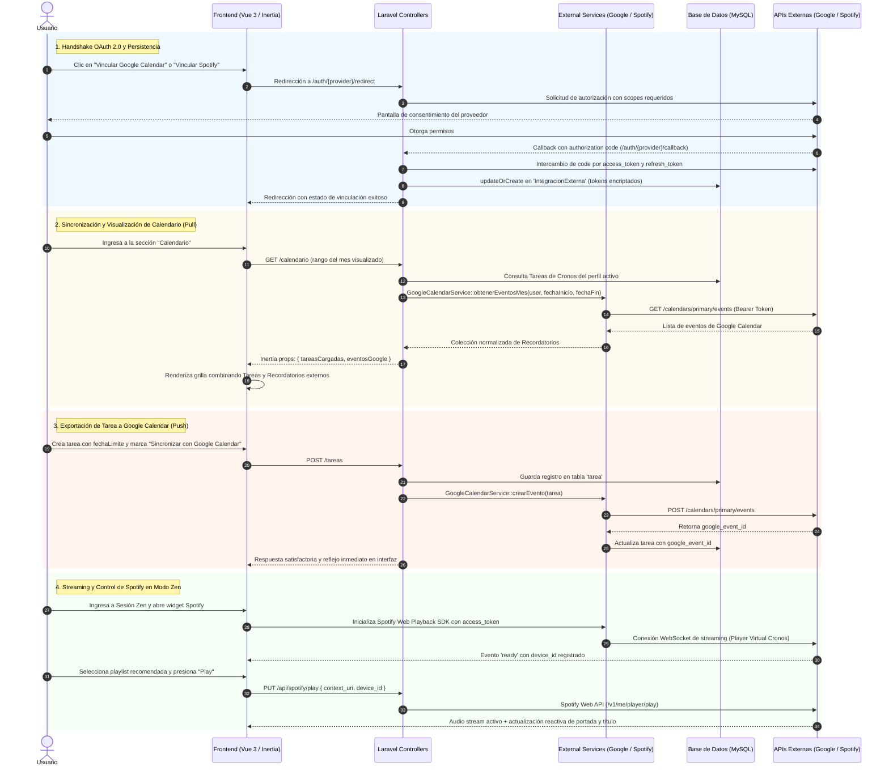

# [RF-M15] Sincronización Completa con Google Calendar y Spotify

## 1. Descripción y Objetivo

Este requerimiento consolida la interoperabilidad del ecosistema Cronos Notes con plataformas líderes de productividad y multimedia (Google Calendar y Spotify), eliminando la fricción y el constante cambio de contexto (*context switching*) que experimentan los estudiantes entre su temporizador Pomodoro, su agenda personal y la reproducción de música ambiental.

El requerimiento comprende dos ejes principales de integración:

### 1.1. Sincronización con Google Calendar
- **Exportación de Compromisos (Cronos ➔ Google Calendar):** Permite exportar automáticamente aquellas tareas que dispongan de fecha y hora límite (`fechaLimite`), así como bloques de sesiones de estudio Pomodoro programadas, insertándolas como eventos en el calendario principal de Google del usuario bajo el tag identificatorio `[Cronos]`.
- **Proyección de Disponibilidad y Recordatorios (Google Calendar ➔ Cronos):** Recupera los eventos programados en Google Calendar y los despliega en la cuadrícula mensual de [`Calendario.vue`](file:///C:/Users/della/cronos-notes/resources/js/Pages/Calendario.vue) bajo la categoría de **Recordatorios / Eventos de Agenda**.
- **Delimitación de Dominio:** Los eventos importados desde Google Calendar **no se convierten en tareas nativas de Cronos Notes**. Esto previene la alteración inadvertida de métricas de rendimiento, porcentajes de completitud de perfiles y el sistema de rachas diarias. El usuario visualiza sus compromisos para prevenir solapamientos y cuenta con la opción manual de *"Convertir en Tarea de Cronos"* si decide dedicar un bloque Pomodoro específico a dicho evento.

### 1.2. Integración Multimedia con Spotify (Web API & Web Playback SDK)
- **Reproductor Embebido en Modo Zen:** Permite a los usuarios con cuenta de Spotify conectar su biblioteca musical y acceder de forma inmediata a tres estilos musicales curados, instrumentales y libres de distracciones vocales para concentración y estudio:
  1. 🎧 **Lofi & Chill Beats:** Ritmos suaves y relajantes (Lofi Hip Hop, Chillhop) ideales para lectura, toma de apuntes y tareas rutinarias.
  2. ☕ **Café & Jazz:** Texturas cálidas de smooth jazz y acústico que recrean la atmósfera distendida y estimulante de una cafetería.
  3. 🎹 **Piano & Clásica Instrumental:** Melodías de piano y composiciones contemporáneas para sesiones de alta carga cognitiva, resolución lógica y matemáticas.
- **Sinergia con el Mezclador de Sonidos Nativo (RF-M06):** Dado que Cronos Notes ya dispone de un mezclador propio de ruidos ambientales (ruido blanco, ruido marrón, lluvia, café, fogata), Spotify no compite ni duplica estos sonidos fónicos, sino que actúa como la capa musical melódica. Esto posibilita una experiencia inmersiva combinada (ej. reproducir una playlist de *Café & Jazz* de Spotify con el sonido nativo de lluvia de fondo de Cronos).
- **Control de Reproducción Nativo en [`SesionZen.vue`](file:///C:/Users/della/cronos-notes/resources/js/Pages/pomodoro/SesionZen.vue):** Control total de streaming (Play, Pausa, Siguiente pista, Pista anterior y Control de volumen) y visualización en tiempo real de carátula de álbum, título de la canción y artista, sin abandonar la pantalla de estudio ni requerir la aplicación de escritorio de Spotify abierta en paralelo.

### 1.3. Objetivo General
Centralizar en un entorno unificado de alta concentración la planificación temporal y el ambiente sonoro del estudiante, mitigando la sobrecarga cognitiva y la dispersión provocada por la alternancia frecuente de ventanas y aplicaciones externas.

---

## 2. Modelo de Dominio: Tareas vs. Recordatorios de Calendario

Para mantener la integridad relacional de la base de datos y la validez pedagógica de las estadísticas, se establece una clara distinción entre las entidades del sistema:

| Criterio | Tarea Nativa (Cronos Notes) | Recordatorio / Evento de Google Calendar |
| :--- | :--- | :--- |
| **Entidad / Persistencia** | Modelo `Tarea` en tabla `tarea` (MySQL) | Consumo dinámico / caché vía Google Calendar API |
| **Vinculación a Perfil** | Obligatoria (`idPerfil`) | Ninguna (agenda personal global del usuario) |
| **Métricas de Rendimiento** | Computa para tareas pendientes, completadas y rachas | **No computa** en estadísticas ni rachas |
| **Representación Visual** | Tarjeta con color de prioridad (Alta: Rojo, Media: Amarillo, Baja: Azul) | Tarjeta con isotipo de Google Calendar, borde diferenciado y horario (`14:00 - 15:30`) |
| **Interacción / Modal** | Permite marcar como completada, editar detalles o iniciar Pomodoro | Permite ver detalles del evento, link a Google Calendar y botón *"Convertir en Tarea de Cronos"* |

---

## 3. Tecnologías, Herramientas y Librerías

- **Laravel Socialite & Google API Client:** Implementación de flujo OAuth 2.0 con alcance incremental (`https://www.googleapis.com/auth/calendar.events` y `calendar.events.readonly`) para lectura y escritura de eventos.
- **Spotify Web API & Spotify Web Playback SDK:** Protocolo OAuth 2.0 (`streaming`, `user-read-playback-state`, `user-modify-playback-state`, `playlist-read-private`) junto al SDK cliente en JavaScript (`https://sdk.scdn.co/spotify-player.js`) para streaming de audio WebSockets en el navegador.
- **Tabla `IntegracionExterna` (Eloquent ORM):** Almacenamiento seguro, encriptado y persistente de tokens (`tokenAcceso`, `refreshToken`, `tokenExpiracion`) para Google y Spotify asociados al `idUsuario`.
- **Inertia.js & Vue 3:** Componentes reactivos en el frontend para el reproductor multimedia y la renderización híbrida de la cuadrícula mensual en el calendario.

---

## 4. Archivos Involucrados en el Requerimiento

### Frontend (Vue 3)
- [`Calendario.vue`](file:///C:/Users/della/cronos-notes/resources/js/Pages/Calendario.vue) - Cuadrícula del calendario mensual que renderiza reactivamente las tareas de Cronos y los eventos externos como recordatorios.
- [`SpotifyPlayer.vue`](file:///C:/Users/della/cronos-notes/resources/js/Pages/pomodoro/components/SpotifyPlayer.vue) - Widget de control musical interactivo con carátula, timeline, selector de playlists y volumen.
- [`SesionZen.vue`](file:///C:/Users/della/cronos-notes/resources/js/Pages/pomodoro/SesionZen.vue) - Integra el widget de Spotify en el entorno inmersivo de estudio.
- [`PerfilUsuario.vue`](file:///C:/Users/della/cronos-notes/resources/js/Pages/PerfilUsuario.vue) - Panel de gestión de cuentas vinculadas (conectar / desconectar Google Calendar y Spotify).

### Backend & Controladores (Laravel)
- `GoogleCalendarController.php` (`/app/Http/Controllers/`) - Endpoints para sincronización manual, lectura de eventos del mes y creación de eventos desde tareas.
- `SpotifyController.php` (`/app/Http/Controllers/`) - Endpoints para gestionar autenticación OAuth con Spotify, refresco de tokens y obtención de playlists recomendadas de estudio.
- `GoogleCalendarService.php` (`/app/Services/`) - Lógica de conexión con Google API (manejo de credenciales, peticiones REST, mapeo de eventos).
- `SpotifyService.php` (`/app/Services/`) - Lógica de comunicación con Spotify Web API y comandos de reproducción.

### Modelos y Migraciones (Eloquent ORM)
- [`IntegracionExterna.php`](file:///C:/Users/della/cronos-notes/app/Models/IntegracionExterna.php) - Almacena las credenciales externas por usuario y plataforma (`GoogleCalendar`, `Spotify`).
- [`Tarea.php`](file:///C:/Users/della/cronos-notes/app/Models/Tarea.php) - Incorpora el campo `google_event_id` para trazabilidad de eventos sincronizados.

---

## 5. Flujo de Datos y Control

### 5.1. Diagrama de Secuencia del Requerimiento

### 5.2. Detalle del Flujo de Control Paso a Paso

1. **Gestión de Autorizaciones y Credenciales (OAuth 2.0):**
   - El usuario inicia la vinculación desde [`PerfilUsuario.vue`](file:///C:/Users/della/cronos-notes/resources/js/Pages/PerfilUsuario.vue).
   - Laravel Socialite o el cliente HTTP redirigen a los proveedores externos con los scopes requeridos:
     - **Google:** `https://www.googleapis.com/auth/calendar.events.readonly` y `calendar.events`.
     - **Spotify:** `streaming`, `user-read-playback-state`, `user-modify-playback-state`, `playlist-read-private`.
   - Tras el consentimiento, el callback intercambia el código de autorización por `access_token` y `refresh_token`, almacenándolos de manera segura en la tabla `IntegracionExterna` vinculados al usuario autenticado.

2. **Flujo de Lectura y Proyección de Calendario (Pull):**
   - Al navegar a `/calendario`, el backend recupera las tareas locales filtradas por el perfil activo y los eventos de Google Calendar para el mes en curso.
   - En [`Calendario.vue`](file:///C:/Users/della/cronos-notes/resources/js/Pages/Calendario.vue), la lógica reactiva clasifica los elementos recibidos:
     - **Tareas locales:** Renderizadas con color de prioridad y acciones de edición/completitud.
     - **Recordatorios externos:** Renderizados con badge de Google Calendar e indicador de horario, sin incidir en el contador de tareas pendientes ni estadísticas.
   - Al interactuar con un recordatorio externo, el modal despliega los datos del evento y permite accionar *"Convertir en Tarea de Cronos"*, abriendo el formulario de tarea precompletado con título y fecha.

3. **Flujo de Exportación de Tareas hacia Google Calendar (Push):**
   - Al crear o editar una tarea con fecha límite y tildar *"Sincronizar con Google Calendar"*, `TareaController` delega a `GoogleCalendarService` la creación del evento en Google.
   - El ID asignado por Google se guarda en `tarea.google_event_id`, garantizando que posteriores cambios de fecha o eliminación de la tarea se sincronicen automáticamente en el calendario externo.

4. **Flujo de Reproducción Multimedia con Spotify:**
   - En [`SesionZen.vue`](file:///C:/Users/della/cronos-notes/resources/js/Pages/pomodoro/SesionZen.vue), se instancia el Web Playback SDK mediante el script oficial de Spotify, registrando un dispositivo de reproducción virtual.
   - El usuario visualiza una galería rápida con los tres estilos musicales curados para concentración (*Lofi & Chill Beats*, *Café & Jazz* y *Piano & Clásica Instrumental*), además del acceso a sus propias listas de Spotify.
   - Al accionar controles de reproducción, el frontend realiza peticiones autorizadas a los endpoints de la Web API de Spotify (`/v1/me/player/play`, `/pause`, `/next`, `/volume`), escuchando los eventos de cambio de estado para actualizar reactivamente la carátula, título y barra de progreso.

---

## 6. Pruebas y Validación (QA)

### Caso de Prueba 1: Vinculación OAuth de Google y Spotify
1. **Precondición:** Usuario autenticado en Cronos Notes.
2. **Paso 1:** Navegar a `/perfil-usuario` y hacer clic en *"Vincular Google Calendar"*.
3. **Paso 2:** Aprobar los permisos solicitados en la pantalla de consentimiento de Google.
4. **Resultado Esperado:** Redirección exitosa al perfil mostrando la insignia verde *"Google Calendar Conectado"* y registro correspondiente creado en la tabla `IntegracionExterna`.

### Caso de Prueba 2: Proyección de Eventos Externos como Recordatorios
1. **Precondición:** Cuenta de Google Calendar vinculada con un evento registrado para el día 15 del mes actual (ej. *"Examen Final de Redes"* de 09:00 a 11:00).
2. **Paso 1:** Ingresar a la sección *"Calendario"* en Cronos Notes.
3. **Paso 2:** Observar la casilla del día 15.
4. **Resultado Esperado:** Se visualiza una tarjeta de tipo **Recordatorio** con el icono de Google Calendar y el horario *"09:00 - 11:00"*. Las estadísticas de tareas del perfil no se modifican. Al hacer clic se despliega el modal de detalle del evento externo con la opción *"Convertir en Tarea"*.

### Caso de Prueba 3: Exportación de Tarea hacia Google Calendar
1. **Precondición:** Google Calendar vinculado.
2. **Paso 1:** Crear una nueva tarea *"Entrega de Trabajo Práctico"* con fecha límite mañana a las 18:00 y marcar el checkbox *"Añadir a Google Calendar"*.
3. **Paso 2:** Guardar la tarea.
4. **Resultado Esperado:** La tarea se persiste en la base de datos local con su respectivo `google_event_id`. Al revisar Google Calendar en una pestaña externa, el evento aparece agendado con el prefijo `[Cronos]`.

### Caso de Prueba 4: Streaming y Control con Spotify en Sesión Zen
1. **Precondición:** Cuenta de Spotify vinculada (usuario con plan compatible).
2. **Paso 1:** Iniciar una Sesión Pomodoro en Modo Zen y abrir el panel de Spotify.
3. **Paso 2:** Seleccionar la lista *"Lofi Focus Beats"* y presionar "Play".
4. **Resultado Esperado:** El streaming comienza a sonar en el navegador. Se visualiza la portada del álbum, título del tema y controles reactivos (Pausa, Salto de pista y Volumen).
