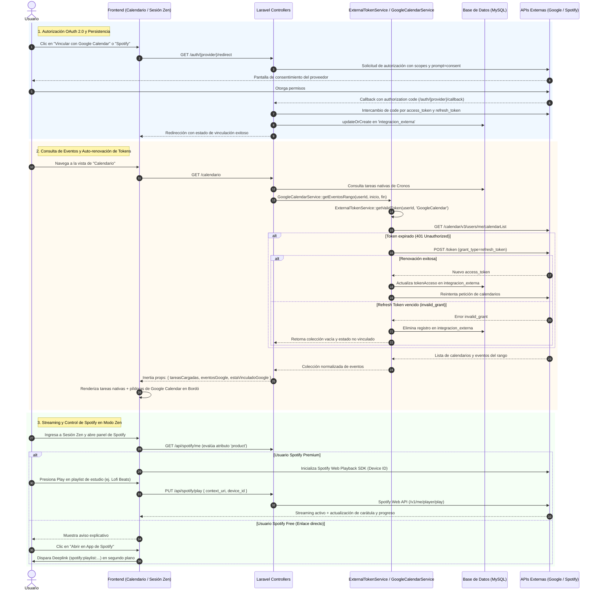

# [RF-M15] Sincronización con Google Calendar y Spotify

## 1. Descripción y Objetivo

Este requerimiento implementa la integración de Cronos Notes con Google Calendar y Spotify, permitiendo a los usuarios visualizar sus compromisos de agenda y controlar música de estudio directamente desde la plataforma sin tener que cambiar de aplicación.

El requerimiento comprende dos ejes principales de integración:

### 1.1. Sincronización con Google Calendar
- **Exportación de Compromisos (Cronos ➔ Google Calendar):** Permite exportar tareas con fecha y hora límite (`fechaLimite`) y bloques de estudio Pomodoro al calendario principal de Google del usuario, identificados con el prefijo `[Cronos]`.
- **Proyección de Agenda y Recordatorios (Google Calendar ➔ Cronos):** Consulta los eventos programados en Google Calendar y los muestra en la vista mensual de [Calendario.vue](/resources/js/Pages/Calendario.vue) como recordatorios diferenciados de las tareas nativas.
- **Delimitación de Dominio:** Los eventos traídos de Google Calendar se muestran en modo de lectura y no se registran como tareas en la base de datos local. Esto evita alterar las métricas de avance, rachas de estudio o porcentajes de cumplimiento del usuario. Si el usuario desea planificar una sesión de estudio en base a un evento externo, dispone de la opción de convertirlo manualmente en una tarea nativa de Cronos.

### 1.2. Integración Musical con Spotify (Web API & Web Playback SDK)
- **Reproductor en Modo Zen:** Permite vincular una cuenta de Spotify para reproducir música instrumental orientada al estudio sin salir del temporizador Pomodoro. Se definen tres listas temáticas:
  1. 🎧 **Lofi & Chill Beats:** Pistas de ritmo tranquilo para lectura y tareas generales.
  2. ☕ **Café & Jazz:** Jazz suave y acústico con ambientación relajada.
  3. 🎹 **Piano & Clásica:** Piezas de piano y música clásica para momentos de mayor concentración.
- **Convivencia con el Mezclador de Sonidos (RF-M06):** El reproductor de Spotify complementa los sonidos ambientales del sistema (lluvia, café, ruido blanco, etc.), permitiendo combinarlos en simultáneo durante la sesión de estudio (por ejemplo, escuchar música lo-fi con sonido de lluvia de fondo).
- **Controles en [SesionZen.vue](/resources/js/Pages/pomodoro/SesionZen.vue):** Controles de reproducción básicos (play, pausa, avanzar, retroceder y volumen) junto con la información de la pista actual (título, artista y portada del álbum).
- **Soporte según Tipo de Cuenta (Premium vs. Free):**
  - **Cuentas Spotify Premium:** Reproducción directa en el navegador mediante el Web Playback SDK de Spotify.
  - **Cuentas Spotify Free:** Debido a restricciones de la API de Spotify para cuentas gratuitas en navegadores web, el sistema detecta el valor `product: 'free'` y ofrece un enlace directo (*deeplink*) para abrir la lista elegida en la aplicación oficial de Spotify (`spotify:playlist:...`), manteniendo el temporizador y el mezclador activos en Cronos Notes.

### 1.3. Modelo de Dominio: Tareas vs. Recordatorios de Calendario

Para mantener la consistencia de las estadísticas de estudio y no mezclar compromisos personales externos con tareas académicas locales, se establece la siguiente distinción:

| Criterio | Tarea Nativa (Cronos Notes) | Recordatorio / Evento de Google Calendar |
| :--- | :--- | :--- |
| **Persistencia** | Modelo `Tarea` en tabla `tarea` (MySQL) | Consulta dinámica vía API de Google Calendar |
| **Vinculación a Perfil** | Obligatoria (`idPerfil`) | Ninguna (pertenece a la cuenta de Google vinculada) |
| **Métricas de Rendimiento** | Computa para tareas pendientes, completadas y rachas | **No computa** en estadísticas ni rachas |
| **Representación Visual** | Tarjeta con color de prioridad (Alta: Rojo, Media: Amarillo, Baja: Azul) | Bloque con ícono de Google Calendar, borde bordó y horario (`14:00 - 15:30`) |
| **Interacción** | Permite marcar como completada, editar o iniciar Pomodoro | Muestra detalles del evento, link a Google Calendar y botón *"Convertir en Tarea"* |

### 1.4. Objetivo General
Unificar la agenda personal y la música de concentración dentro del entorno de estudio de Cronos Notes, reduciendo la necesidad de alternar entre pestañas y aplicaciones externas durante las sesiones de estudio.

---

## 2. Tecnologías, Herramientas y Librerías

- **Google Calendar API (v3):** Endpoints REST oficiales para consultar calendarios activos (`/calendarList`) y eventos por rango de fechas (`/calendars/{calendarId}/events`), con soporte para calendarios primarios y secundarios.
- **Spotify Web API & Web Playback SDK:** Protocolo OAuth 2.0 y biblioteca JavaScript (`spotify-player.js`) para transferir la reproducción y controlar el audio dentro del navegador.
- **Laravel Socialite & GuzzleHttp:** Gestión del flujo de autorización OAuth 2.0 e intercambio de credenciales. Se configuró el cliente Guzzle con verificación SSL adaptable para resolver problemas con certificados locales en entornos de desarrollo Windows.
- **Tabla `integracion_externa` (Eloquent ORM):** Tabla relacional donde se almacenan y renuevan los tokens de acceso y actualización (`tokenAcceso`, `tokenNuevo`), asociando la plataforma externa al usuario de Cronos.
- **Inertia.js & Vue 3 (Composition API):** Comunicación reactiva entre los controladores de Laravel y las vistas de Vue sin recargas completas de página.
- **Bootstrap 5 & Bootstrap Icons:** Maquetación de la cuadrícula del calendario, modales de detalle (`modalVerDetalleGoogle`) e iconografía.
- **CSS3 y Paleta Institucional Bordó:** Estilos personalizados para los eventos externos con borde y tipografía bordó (`#612c2d`), con compatibilidad completa para modo claro y modo oscuro.

---

## 3. Archivos Involucrados en el Requerimiento

### Frontend (Vue 3)
- [Calendario.vue](/resources/js/Pages/Calendario.vue) - Cuadrícula del calendario mensual. Renderiza las tareas nativas y los eventos externos en formato de píldora bordó (`.bloque-google-item`). Incluye el modal `#modalVerDetalleGoogle` y el panel lateral de estado de sincronización.
- [SpotifyPlayer.vue](/resources/js/Pages/pomodoro/components/SpotifyPlayer.vue) - Componente del reproductor de música con portada de álbum, título, artista, control de volumen, selector de listas curadas y gestión del enlace externo para cuentas gratuitas.
- [SesionZen.vue](/resources/js/Pages/pomodoro/SesionZen.vue) - Vista de estudio del temporizador Pomodoro que integra el reproductor de Spotify junto con el mezclador de sonidos ambientales.
- [PerfilUsuario.vue](/resources/js/Pages/PerfilUsuario.vue) - Sección de configuración donde el usuario puede conectar, comprobar y desvincular las cuentas de Google Calendar y Spotify.

### Backend & Controladores (Laravel)
- [GoogleCalendarController.php](/app/Http/Controllers/GoogleCalendarController.php) - Controlador que maneja la redirección a Google, el callback de autorización, la desconexión y la prueba de conectividad.
- [SpotifyController.php](/app/Http/Controllers/SpotifyController.php) - Controlador que gestiona la autenticación con Spotify, la consulta de datos del perfil (`/v1/me`) y la selección de listas.
- [GoogleAuthController.php](/app/Http/Controllers/Auth/GoogleAuthController.php) - Controlador de autenticación con Google Login con configuración SSL adaptada a desarrollo local.

### Servicios de Negocio (Backend Services)
- [GoogleCalendarService.php](/app/Services/GoogleCalendarService.php) - Servicio que realiza las consultas a la API de Google Calendar: listado de calendarios del usuario, filtrado por fechas y normalización de eventos.
- [ExternalTokenService.php](/app/Services/ExternalTokenService.php) - Servicio encargado de recuperar y renovar tokens de acceso. Detecta respuestas `invalid_grant` para eliminar automáticamente registros vencidos y mantener la interfaz sincronizada.

### Modelos y Datos (Eloquent ORM)
- [IntegracionExterna.php](/app/Models/IntegracionExterna.php) - Modelo Eloquent para la tabla `integracion_externa` para persistir los tokens OAuth y fechas de sincronización.
- [Tarea.php](/app/Models/Tarea.php) - Modelo de tareas utilizado para la comparación de dominio y la conversión opcional de eventos externos en tareas de Cronos.

### Enrutamiento y Base de Datos
- [web.php](/routes/web.php) - Definición de rutas web y de API para el flujo de vinculación, endpoints de eventos y control de Spotify.
- [auth.php](/routes/auth.php) - Rutas de autenticación OAuth para Google Login (`/auth/google` y `/auth/google/callback`).
- [services.php](/config/services.php) - Configuración de credenciales de cliente OAuth, URLs de callback y parámetros HTTP de Guzzle para Google y Spotify.
- [2026_01_01_000010_create_integracion_externa_table.php](/database/migrations/2026_01_01_000010_create_integracion_externa_table.php) - Migración de base de datos para la estructura de la tabla `integracion_externa`.

---

## 4. Flujo de Datos y Control

### 4.1. Diagrama de Secuencia General del Requerimiento

### 4.2. Detalle del Flujo de Control Paso a Paso

1. **Autorización y Vinculación Inicial (OAuth 2.0):**
   - El usuario pulsa *"Vincular con Google Calendar"* desde el perfil o el calendario.
   - La aplicación redirige a Google solicitando acceso offline (`access_type=offline`) y forzando la pantalla de consentimiento (`prompt=consent`) para asegurar la recepción del *refresh token*.
   - El cliente HTTP de Guzzle evalúa el entorno de ejecución: en desarrollo local omite la verificación estricta de certificados para evitar errores de cURL en Windows.
   - Una vez autorizado, el callback recibe el código, lo intercambia por las credenciales y las guarda en la tabla `integracion_externa`.

2. **Consulta y Visualización de la Agenda:**
   - Al abrir `/calendario`, el backend solicita a `GoogleCalendarService` los eventos en un rango amplio de fechas para facilitar la navegación entre meses sin demoras de carga.
   - El servicio consulta la lista de calendarios del usuario y recupera los eventos de cada uno, consolidando fecha, horario de inicio y fin, título y enlace de acceso.
   - `Calendario.vue` procesa los eventos y los ubica en los días correspondientes con la clase `.bloque-google-item`, diferenciados visualmente con un tono bordó institucional.
   - Al pulsar un evento se abre el modal `#modalVerDetalleGoogle` con el detalle completo y el enlace para abrirlo directamente en Google Calendar.

3. **Renovación y Limpieza de Credenciales (`invalid_grant`):**
   - Cuando el token de acceso expira, el sistema solicita automáticamente uno nuevo a la API usando el token de actualización.
   - Si el token de actualización fue revocado o venció (como ocurre tras 7 días en aplicaciones en modo de prueba de Google Cloud), la API responde con `invalid_grant`.
   - `ExternalTokenService` captura esta excepción, borra el registro de la tabla `integracion_externa` y establece `estaVinculadoGoogle = false`.
   - La vista de calendario refleja el cambio de forma inmediata y vuelve a habilitar el botón *"Vincular con Google Calendar"*, permitiendo reconectar la cuenta sin fallos de servidor ni bloqueos en la interfaz.

---

## 5. Pruebas y Validación (QA)

### Caso de Prueba 1: Vinculación con Google Calendar
1. **Precondición:** Usuario autenticado en Cronos Notes sin integración de Google Calendar activa.
2. **Paso 1:** Ingresar a `/calendario` o `/perfil-usuario` y presionar *"Vincular con Google Calendar"*.
3. **Paso 2:** Seleccionar la cuenta de Google y aceptar los permisos solicitados.
4. **Resultado Esperado:** Redirección a Cronos Notes con mensaje de confirmación, registro creado en la tabla `integracion_externa` y presencia del indicador *"Google Calendar Sincronizado"* en la barra lateral del calendario.

### Caso de Prueba 2: Visualización de Eventos en Cuadrícula y Modal de Detalle
1. **Precondición:** Cuenta de Google Calendar vinculada con al menos un evento en la fecha actual (por ejemplo, *"Reunión de Proyecto"* a las 15:00).
2. **Paso 1:** Navegar a la sección *"Calendario"*.
3. **Paso 2:** Revisar el casillero de la fecha actual.
4. **Resultado Esperado:** El evento aparece con formato de bloque con fondo claro, borde izquierdo y texto en color bordó (`#612c2d`), junto con el ícono de calendario y el horario. Al hacer clic, se abre el modal `#modalVerDetalleGoogle` mostrando la descripción completa y el enlace a Google Calendar.

### Caso de Prueba 3: Manejo de Token Revocado o Vencido
1. **Precondición:** Integración de Google Calendar guardada con un token revocado o modificado manualmente en la base de datos.
2. **Paso 1:** Recargar la página `/calendario`.
3. **Resultado Esperado:** El sistema detecta el error `invalid_grant`, elimina el registro de `integracion_externa` sin producir errores 500 y actualiza la vista mostrando nuevamente el botón *"Vincular con Google Calendar"*.

### Caso de Prueba 4: Reproducción de Música con Spotify Premium en Modo Zen
1. **Precondición:** Usuario con cuenta Spotify Premium conectada desde `/perfil-usuario`.
2. **Paso 1:** Iniciar una sesión Pomodoro y presionar el botón de *"Sesión Zen"*.
3. **Paso 2:** Abrir el panel de Spotify, seleccionar una de las listas (por ejemplo, *"Lofi & Chill Beats"*) y presionar "Play".
4. **Resultado Esperado:** El Web Playback SDK inicia la reproducción directamente en el navegador, mostrando la portada del álbum, título de la pista, artista y controles de reproducción y volumen.

### Caso de Prueba 5: Comportamiento con Cuenta Spotify Free
1. **Precondición:** Usuario con cuenta gratuita de Spotify vinculada (`product: 'free'`).
2. **Paso 1:** Ingresar a Sesión Zen y abrir el panel de Spotify.
3. **Resultado Esperado:** El componente detecta la cuenta gratuita y muestra un mensaje indicando que la reproducción web directa requiere suscripción Premium. Ofrece el botón *"Abrir en App de Spotify"* con el deeplink (`spotify:playlist:...`) para iniciar la lista en la aplicación de Spotify sin interrumpir el temporizador Pomodoro en Cronos Notes.

---

## 6. Diseño de Frontend (Capturas para el Informe)

Para el informe final y la documentación del proyecto, se sugiere incluir las siguientes 5 capturas de pantalla que muestran las pantallas y componentes desarrollados:

| N° | Captura Sugerida | Ubicación / Pantalla | Qué debe mostrarse en la imagen |
| :---: | :--- | :--- | :--- |
| **1** | **Gestión de Integraciones en Perfil de Usuario** | Ruta: `/perfil-usuario` | Tarjetas de **Google Calendar** y **Spotify** dentro de la sección *"Integraciones Externas"*, mostrando el estado *"Conectado"*, botón de prueba de conexión y botón de desvincular. |
| **2** | **Calendario Mensual con Eventos de Google Calendar (Modo Claro)** | Ruta: `/calendario` | Cuadrícula mensual con tareas locales conviviendo con los eventos externos de Google Calendar en color bordó (`#612c2d`), con ícono de calendario y horario. En la barra lateral se observa el indicador *"Google Calendar Sincronizado"*. |
| **3** | **Modal de Detalle de Evento Externo** | Ruta: `/calendario` (modal abierto) | Modal `#modalVerDetalleGoogle` abierto tras pulsar un evento, mostrando cabecera en bordó, etiqueta *"Evento de Google Calendar"*, título, descripción, horario y el botón *"Ver en Google Calendar"*. |
| **4** | **Calendario en Modo Oscuro (Dark Mode)** | Ruta: `/calendario` (tema oscuro activo) | Misma cuadrícula bajo el tema oscuro (`cn-body-dark`), evidenciando la adaptación de contraste en los bloques bordó (`#3b2020`), bordes claros y texto legible (`#ffd8bf`). |
| **5** | **Reproductor de Spotify en Modo Zen** | Ruta: `/sesion-zen` (panel Spotify abierto) | Vista de pantalla completa con el temporizador Pomodoro en marcha, el widget de Spotify reproduciendo música (portada, tema activo y controles de volumen) y el mezclador ambiental activo en simultáneo. |
