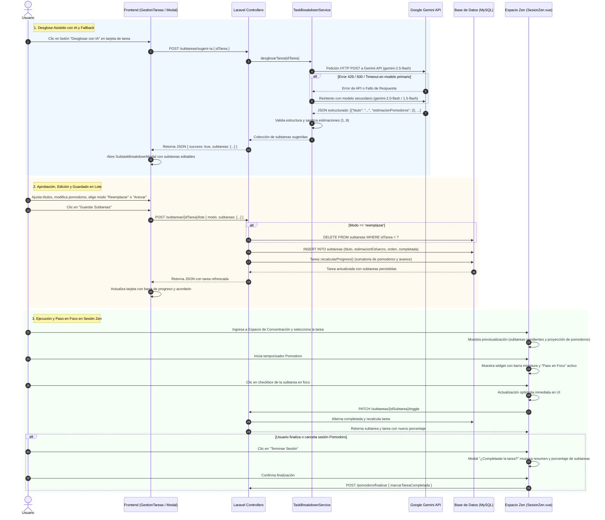

# [RF-M16] Desglose Automático de Tareas con IA (Subtareas Inteligentes)

## 1. Descripción y Objetivo

Este requerimiento implementa un asistente inteligente dentro de Cronos Notes para combatir la procrastinación y la sobrecarga cognitiva derivada de proyectos complejos. Permite desglosar automáticamente tareas de gran alcance en una secuencia lógica de subtareas accionables, cuantificadas en bloques de tiempo Pomodoro (25 minutos), gestionables tanto desde el módulo de tareas como durante la ejecución en el Espacio de Concentración.

El requerimiento comprende tres ejes fundamentales de funcionalidad:

### 1.1. Desglose Automático con Inteligencia Artificial
- **Generación Asistida por IA (Gemini API):** A partir del título y la descripción de una tarea existente, el servicio `TaskBreakdownService` consulta modelos de lenguaje avanzados solicitando un plan secuencial de entre 3 y 7 subtareas accionables.
- **Estrategia de Fallback Multi-modelo:** Para maximizar la disponibilidad y mitigar cuotas o degradaciones del servicio de IA, el backend implementa una cadena de contingencia automática (`gemini-2.5-flash` ➔ `gemini-2.0-flash` ➔ `gemini-1.5-flash`). Si el modelo primario no responde o agota su cuota, el sistema conmuta transparentemente al siguiente sin interrumpir la experiencia del usuario.
- **Calibración y Sanitización de Esfuerzo:** Cada subtarea propuesta incluye una estimación recomendada en bloques Pomodoro (1 a 4 pomodoros). El servicio valida y normaliza estas cantidades antes de enviarlas al cliente, garantizando realismo operativo.

### 1.2. Gestión Interactiva y Guardado en Lote
- **Modal de Revisión y Edición ([SubtaskBreakdownModal.vue](/resources/js/Components/SubtaskBreakdownModal.vue)):** Antes de confirmar la inserción, el usuario puede modificar títulos, reajustar estimaciones de pomodoros, agregar pasos manuales o descartar sugerencias que considere redundantes.
- **Modos de Persistencia Flexibles (Reemplazar vs. Anexar):** Si la tarea ya contaba con subtareas previas, el usuario decide si desea reemplazar la estructura existente o anexar los nuevos pasos al final de la lista manteniendo el orden correlativo.
- **Gestión Manual en Tarjeta y Modal de Detalle ([GestionTareas.vue](/resources/js/Pages/GestionTareas.vue)):** Permite crear, renombrar, tildar y eliminar subtareas de forma individual, visualizando una barra de progreso porcentual y un acordeón interactivo en cada tarjeta.

### 1.3. Integración en el Espacio de Concentración (Sesión Zen)
- **Previsualización en Configuración (Setup):** Al seleccionar una tarea antes de iniciar la sesión Pomodoro, se despliega una tarjeta de resumen con la cantidad de subtareas pendientes y la proyección total de pomodoros estimados.
- **Paso a Paso en Foco (Focus Step):** En el widget del temporizador activo, justo debajo del nombre de la tarea, se exhibe la primera subtarea pendiente con casilla de verificación interactiva y badge de pomodoros. El usuario puede marcarla como completada con actualización optimista inmediata sin salir de su flujo de trabajo.
- **Acordeón Desplegable en Temporizador:** Permite expandir la lista completa en un contenedor con scroll interno para verificar o conmutar cualquier subtarea fuera de orden.
- **Resumen al Finalizar Sesión:** Al concluir o cancelar el temporizador, el modal de confirmación (*¿Completaste la tarea?*) exhibe el balance de subtareas terminadas vs. pendientes para brindar retroalimentación clara.

### 1.4. Modelo de Dominio: Tareas Principales vs. Subtareas

Para asegurar la coherencia en las métricas de rendimiento y la precisión de las estadísticas de estudio, se define la siguiente delimitación estructural:

| Criterio | Tarea Principal (`Tarea`) | Subtarea Inteligente (`Subtarea`) |
| :--- | :--- | :--- |
| **Persistencia** | Tabla `tarea` (MySQL) | Tabla `subtareas` con clave foránea `idTarea` |
| **Pertenencia** | Vinculada directamente al perfil activo (`idPerfil`) | Vinculada a su tarea contenedora (`CASCADE DELETE`) |
| **Estimación de Esfuerzo** | Recalibrada dinámicamente como la sumatoria de pomodoros de sus subtareas hijas (o valor base manual) | Valor entero positivo (1 a 8 pomodoros) por bloque específico |
| **Progreso y Avance** | Porcentaje `progreso` (0% a 100%) calculado como `(completadas / total) * 100` | Estado binario booleano (`completada: true / false`) |
| **Impacto en Estados** | Estados: *Pendiente*, *En Progreso*, *Completado* | Actualiza automáticamente el estado de la tarea padre |
| **Visualización Zen** | Identificada en el badge principal del temporizador | Exhibida como paso en foco individual y acordeón interactivo |

### 1.5. Objetivo General
Transformar metas complejas o intimidantes en planes de acción pequeños, medibles y ejecutables paso a paso, integrando la planificación por IA con la disciplina temporal de la técnica Pomodoro y garantizando soporte visual impecable en temas claro y oscuro.

---

## 2. Tecnologías, Herramientas y Librerías

- **Google Gemini API (`v1beta` REST API):** Generación estructurada de subtareas mediante `generateContent`, prompts con rol de tutor de productividad y formato JSON forzado.
- **Laravel 11 HTTP Client (`Http::withHeaders`):** Peticiones seguras con timeout de 20s, captura de excepciones (`RequestException`) y gestión de fallback multi-modelo (`gemini-2.5-flash`, `gemini-2.0-flash`, `gemini-1.5-flash`).
- **MySQL & Eloquent ORM:** Migración `2026_11_13_000001_create_subtareas_table.php` con tabla `subtareas`, campos `idTarea`, `titulo`, `completada`, `estimacionEsfuerzo`, `orden`, e índices optimizados.
- **Inertia.js & Vue 3 (Composition API):** Gestión de estado reactivo, actualizaciones optimistas en memoria con `JSON.parse(JSON.stringify())` y sincronización instantánea sin refrescos de página.
- **Axios & CSRF Protection:** Comunicación cliente-servidor con token `X-CSRF-TOKEN` inyectado vía `<meta name="csrf-token">` y cabeceras `X-Requested-With: XMLHttpRequest` para respuestas JSON asíncronas limpias.
- **CSS3 y Sistema de Diseño Cronos:** Soporte integral para modo claro y modo oscuro (`.cn-body-dark`, `.pomodoro-zen-container.dark-mode`), fondos sutiles transparentes, pills de pomodoro libres de fondos rígidos y animación fluida en barras de progreso.
- **PHPUnit & Testing Automatizado:** Pruebas de integración y cobertura con 11 tests de feature de subtareas y 6 tests de servicio de IA pasando al 100%.

---

## 3. Archivos Involucrados en el Requerimiento

### Frontend (Vue 3)
- [SubtaskBreakdownModal.vue](/resources/js/Components/SubtaskBreakdownModal.vue) - Modal de generación y edición de subtareas sugeridas por IA. Permite alternar entre modos reemplazar/anexar, editar textos, ajustar pomodoros y guardar en lote con Axios.
- [GestionTareas.vue](/resources/js/Pages/GestionTareas.vue) - Vista principal de tareas. Incorpora botón de desglose por IA, barra de progreso con gradiente Cronos, acordeón colapsable en tarjeta y formulario manual de subtareas en el modal de detalle.
- [SesionZen.vue](/resources/js/Pages/pomodoro/SesionZen.vue) - Espacio de Concentración. Añade previsualización en configuración (setup), paso activo en foco con checkbox dentro del widget de temporizador, acordeón deslizable, indicador minimizado y feedback de avance en el modal de finalización.

### Backend & Controladores (Laravel)
- [SubtareaController.php](/app/Http/Controllers/SubtareaController.php) - Controlador REST que gestiona creación manual, edición, conmutación (`toggle`), eliminación y persistencia en lote (`guardarLote`) con validación de roles y permisos del perfil.
- [PomodoroController.php](/app/Http/Controllers/PomodoroController.php) - Modificado para cargar mediante `with(['subtareas' => fn($q) => $q->orderBy('orden', 'asc')])` las tareas activas y asegurar su disponibilidad en la sesión Zen.

### Servicios de Negocio (Backend Services)
- [TaskBreakdownService.php](/app/Services/TaskBreakdownService.php) - Servicio que construye el prompt especializado, administra la cascada de fallback entre modelos Gemini, valida las respuestas JSON y sanitiza las estimaciones de esfuerzo.

### Modelos y Datos (Eloquent ORM)
- [Subtarea.php](/app/Models/Subtarea.php) - Modelo Eloquent con relaciones `belongsTo(Tarea::class)`, casting de campos (`completada: boolean`, `estimacionEsfuerzo: integer`) y asignación masiva.
- [Tarea.php](/app/Models/Tarea.php) - Relación `hasMany(Subtarea::class)` y método de dominio `recalcularProgreso()` para calibrar automáticamente `estimacionEsfuerzo`, porcentaje de avance y estados transicionales.

### Enrutamiento, Migraciones y Vistas
- [web.php](/routes/web.php) - Declaración de endpoints protegidos por autenticación y verificación de perfil: `POST /subtareas/sugerir-ia`, `POST /subtareas/{idTarea}/lote`, `POST /subtareas/{idTarea}`, `PATCH /subtareas/{idSubtarea}`, `PATCH /subtareas/{idSubtarea}/toggle`, `DELETE /subtareas/{idSubtarea}`.
- [2026_11_13_000001_create_subtareas_table.php](/database/migrations/2026_11_13_000001_create_subtareas_table.php) - Migración de base de datos para la creación de la tabla `subtareas`.
- [app.blade.php](/resources/views/app.blade.php) - Inclusión de `<meta name="csrf-token" content="{{ csrf_token() }}">` requerida para peticiones Axios desde modales dinámicos.

### Pruebas Automatizadas (Tests)
- [SubtareaFeatureTest.php](/tests/Feature/SubtareaFeatureTest.php) - Pruebas de integración sobre CRUD de subtareas, políticas de lector/editor, recálculo de esfuerzo, borrado en cascada, guardado en lote y carga ansiosa en el controlador Pomodoro.
- [TaskBreakdownServiceTest.php](/tests/Feature/TaskBreakdownServiceTest.php) - Pruebas unitarias y de integración simulando respuestas exitosas de Gemini, rechazo a tareas sin descripción, control de roles, activación de fallbacks ante fallos de servidor (500) y sanitización de límites.

---

## 4. Flujo de Datos y Control

### 4.1. Diagrama de Secuencia General del Requerimiento



### 4.2. Detalle del Flujo de Control Paso a Paso

1. **Solicitud de Desglose Inteligente:**
   - Desde la vista de `GestionTareas.vue`, el usuario pulsa el botón con ícono de varita / descomposición en una tarea que cuenta con título y descripción.
   - El frontend despacha una petición asíncrona a `/subtareas/sugerir-ia` con el identificador de la tarea.
   - `TaskBreakdownService` verifica que el usuario posea permisos de modificación en el perfil correspondiente y arma el prompt con directivas de rol, formato JSON y restricciones de secuencialidad.

2. **Inferencia con Fallback Multi-modelo:**
   - Se inicia la consulta con `gemini-2.5-flash`.
   - Si la API responde satisfactoriamente, se extrae el bloque JSON utilizando expresiones regulares para descartar bloques de markdown (` ```json `).
   - Si ocurre un error de cuota (429), caída temporal del servicio (500/503) o timeout, el servicio captura la excepción, registra el incidente en los logs y reintenta de inmediato con `gemini-2.0-flash` o `gemini-1.5-flash`.
   - La respuesta resultante se somete a validación de tipos, descartando registros vacíos y fijando valores de pomodoros válidos.

3. **Revisión Interactiva en Modal:**
   - `SubtaskBreakdownModal.vue` recibe el listado y lo presenta al usuario en una tabla interactiva.
   - El usuario puede editar directamente los textos de cada subtarea, aumentar o reducir los pomodoros recomendados, añadir nuevas filas con el botón *"Agregar paso"* o descartar ítems innecesarios.
   - El modal calcula y exhibe en tiempo real el total de pomodoros proyectados y la cantidad de pasos a crear.

4. **Persistencia Transaccional y Recálculo de Progreso:**
   - Al pulsar *"Guardar Subtareas"*, el cliente efectúa un `POST` con Axios a `/subtareas/{idTarea}/lote`.
   - En modo *"Reemplazar"*, se suprimen las subtareas preexistentes y se crean las nuevas con numeración de orden correlativa. En modo *"Anexar"*, se calculan los nuevos índices a partir del mayor orden existente.
   - Se invoca `recalcularProgreso()` en el modelo `Tarea`, recalculando el atributo `estimacionEsfuerzo` como la sumatoria de pomodoros de las subtareas y recalculando `progreso` en base al ratio de subtareas completadas.

5. **Interacción Continua en el Espacio de Concentración:**
   - Al acceder a `SesionZen.vue`, el controlador inyecta la colección de tareas con sus subtareas ya cargadas ansiosamente.
   - Al seleccionar la tarea en el configurador previo, el usuario visualiza la cantidad de subtareas pendientes y el esfuerzo estimado.
   - Durante la sesión activa, el temporizador expone de forma destacada el **Paso en Foco** (primera subtarea pendiente).
   - El usuario puede tildar la subtarea directamente desde el widget; la interfaz responde de manera instantánea (optimista) y envía en segundo plano un `PATCH` a `/subtareas/{idSubtarea}/toggle`.
   - Si el usuario desea inspeccionar o marcar otros pasos, pulsa *"Ver todas"* para desplegar el acordeón completo sin abandonar la concentración.

---

## 5. Pruebas y Validación (QA)

### Caso de Prueba 1: Desglose Automático con IA y Previsualización en Modal
1. **Precondición:** Usuario autenticado en Cronos Notes con una tarea creada que contiene título *"Redactar tesis de licenciatura"* y descripción detallada de sus objetivos.
2. **Paso 1:** Ingresar a `/tareas` y presionar el botón "Desglosar con IA" en la tarjeta de la tarea.
3. **Paso 2:** Esperar la resolución del procesamiento en segundo plano.
4. **Resultado Esperado:** Se abre el componente `SubtaskBreakdownModal` mostrando una lista de entre 3 y 7 subtareas coherentes (ej. *"1. Definir marco metodológico"*, *"2. Recopilar bibliografía especializada"*), cada una con una estimación realista de entre 1 y 4 pomodoros y el badge visual del tomate sin fondos blancos antiestéticos.

### Caso de Prueba 2: Activación Silenciosa de Fallback Multi-modelo
1. **Precondición:** Simulación de indisponibilidad o clave saturada en el modelo primario de Gemini (`gemini-2.5-flash`).
2. **Paso 1:** Solicitar el desglose de una tarea mediante el endpoint `/subtareas/sugerir-ia`.
3. **Resultado Esperado:** `TaskBreakdownService` captura el fallo del primer modelo, conmuta de forma automática e invisible al modelo secundario en la cadena de contingencia y entrega exitosamente el conjunto de subtareas estructuradas al cliente sin arrojar errores 500.

### Caso de Prueba 3: Guardado en Lote con Modos Reemplazar y Anexar
1. **Precondición:** Una tarea que ya posee 2 subtareas guardadas previamente (*"Paso 1"*, *"Paso 2"*).
2. **Paso 1:** Abrir el modal de desglose y editar la propuesta de la IA agregando un paso manual adicional.
3. **Paso 2 (Anexar):** Seleccionar la opción *"Anexar al final"* y presionar "Guardar Subtareas".
4. **Resultado Esperado (Anexar):** La tarea preserva los 2 pasos iniciales y suma los nuevos con numeración correlativa (`orden: 3, 4...`), recalculando la estimación global de la tarea.
5. **Paso 3 (Reemplazar):** Ejecutar un nuevo desglose seleccionando *"Reemplazar existentes"* y confirmar.
6. **Resultado Esperado (Reemplazar):** Las subtareas anteriores se eliminan por completo y son sustituidas por el nuevo lote confirmado.

### Caso de Prueba 4: Paso en Foco e Interacción dentro del Espacio de Concentración
1. **Precondición:** Iniciar sesión con una tarea asociada que cuenta con 3 subtareas pendientes.
2. **Paso 1:** Acceder a la ruta `/sesion-zen` y elegir la tarea en el configurador previo (observar la previsualización de subtareas y pomodoros proyectados).
3. **Paso 2:** Iniciar el temporizador Pomodoro.
4. **Resultado Esperado (Paso en Foco):** En el widget del temporizador aparece la barra de progreso indicando `0 de 3 (0%)` y la tarjeta destacada con el **Paso en Foco** mostrando la primera subtarea y su casilla de verificación.
5. **Paso 3:** Pulsar la casilla de la subtarea en foco.
6. **Resultado Esperado (Conmutación):** La casilla se marca inmediatamente como completada, el contador pasa a `1 de 3 (33%)`, la barra de progreso se llena proporcionalmente y el widget promueve automáticamente la siguiente subtarea pendiente como nuevo paso en foco.
7. **Paso 4:** Pulsar "Terminar Sesión".
8. **Resultado Esperado (Feedback Modal):** El modal de confirmación exhibe el estado del avance de subtareas indicando que restan 2 pasos pendientes.

### Caso de Prueba 5: Consistencia Visual en Modos Claro y Oscuro
1. **Precondición:** Tarea con subtareas desplegada en la pantalla de tareas y en el Espacio Zen.
2. **Paso 1:** Alternar el tema del sistema entre modo claro y modo oscuro (`localStorage: cn-theme`).
3. **Resultado Esperado:** En modo claro, los elementos de subtarea exhiben tipografía oscura (#3b1717), fondos suaves (#fcfbf9) y bordes bordó sutiles (#7b413f). En modo oscuro, los textos pasan a blanco (#ffffff) o pastel (#fcd5b8), con fondos translúcidos oscuros de contraste alto (#612c2d / rgba(0,0,0,0.25)), sin componentes ilegibles ni cajas blancas cuadradas.

---

## 6. Diseño de Frontend (Capturas para el Informe)

Para la confección del informe de ingeniería y la documentación técnica final, se sugiere incorporar las siguientes 5 capturas de pantalla representativas de los componentes desarrollados:

| N° | Captura Sugerida | Ubicación / Pantalla | Qué debe mostrarse en la imagen |
| :---: | :--- | :--- | :--- |
| **1** | **Modal de Desglose Inteligente con IA** | Ruta: `/tareas` (modal activo) | Componente `SubtaskBreakdownModal.vue` abierto con la lista de subtareas sugeridas por Gemini, inputs editables, badges de pomodoros (`🍅`), selector de modo *"Reemplazar / Anexar"* y botón de confirmación en lote. |
| **2** | **Tarjeta de Tarea con Acordeón y Progreso (Modo Claro)** | Ruta: `/tareas` | Tarjeta de tarea en `GestionTareas.vue` con la barra de progreso de subtareas (`X de Y (Z%)`), botón de desglose por IA y el acordeón interactivo desplegado con su checklist. |
| **3** | **Espacio de Concentración con Paso en Foco Activo** | Ruta: `/sesion-zen` (temporizador en marcha) | Widget flotante del temporizador Pomodoro en `SesionZen.vue` mostrando el badge de la tarea activa, la barra miniatura de progreso y la tarjeta destacada del **Paso en Foco** con su checkbox y pomodoros. |
| **4** | **Acordeón Completo de Subtareas en Temporizador Zen** | Ruta: `/sesion-zen` (modo desplegado) | El mismo widget del temporizador con el acordeón *"Ver todas"* desplegado, mostrando el listado con scroll interno de todas las subtareas tildadas y pendientes. |
| **5** | **Feedback al Finalizar Sesión y Tema Oscuro** | Ruta: `/sesion-zen` (modo oscuro) | Pantalla en modo oscuro (`cn-body-dark`) con el modal *¿Completaste la tarea?* activo, exhibiendo la tarjeta de resumen de progreso de subtareas con tipografía de alto contraste y colores institucionales. |
